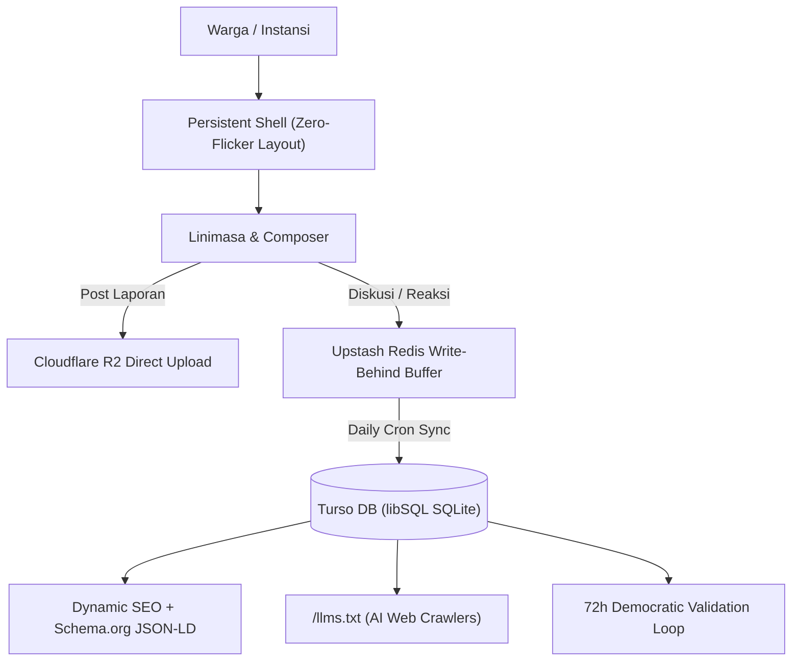

<div align="center">
  
  <h1>Kavi</h1>
  <p><strong>Ruang Suara & Laporan Warga</strong></p>
  <p><em>Platform civic technology terbuka yang menjembatani warga dengan instansi pemerintah di 38 provinsi Indonesia untuk melaporkan permasalahan infrastruktur dan layanan publik secara transparan, berbasis bukti visual, serta termonitor hingga tuntas.</em></p>

  <p>
    <a href="https://app.kavi.jeki.me">
      
    </a>
  </p>

  <p>
    
    
    
    
    
    
    
    
  </p>
</div>

---

## 1. Tech Stack

| Layer | Teknologi | Peran |
| :--- | :--- | :--- |
| **Framework** | **Next.js 15 (App Router)** & **React 19** | SSR, Client Components, Server Actions, Route Handlers |
| **Language** | **TypeScript 5** | Strict type-safety di skema DB, API contracts, dan komponen antarmuka |
| **Styling** | **Pure CSS (`app/globals.css`)** | Custom design system tanpa dependensi UI bloat, fluid typography (*Plus Jakarta Sans*) |
| **Database** | **Turso (libSQL Cloud SQLite)** | Distributed edge database untuk persistensi relasional laporan, topik, dan komentar |
| **ORM** | **Drizzle ORM** | Schema definition, automated migrations, type-safe queries & relational joins |
| **Authentication** | **NextAuth.js v5 (Auth.js)** | Google OAuth 2.0 provider, session management, dan isolated demo identity fallback |
| **Object Storage** | **Cloudflare R2 (S3-compatible)** | Penyimpanan bukti visual laporan via presigned URLs & CDN `s3.kavi.jeki.me` |
| **Cache / Write-Behind** | **Upstash Redis (REST API)** | Write-behind buffer hitungan interaksi (*upvotes/views*) & rate-limiting cooldown |
| **Icons & Media** | **Lucide React** | Ikon antarmuka modular |
| **Testing & SEO** | **tsx + Node assert** | Test suite otomatis untuk dynamic SEO, Schema.org JSON-LD, sitemap, dan `llms.txt` |

---

## 2. Cara Menjalankan Project

### Prasyarat
- **Node.js** >= 18.18.0
- **pnpm** >= 9.x
- Kredensial aktif: Turso DB, Cloudflare R2, Google Cloud Console (OAuth), dan Upstash Redis.

### Langkah-langkah
```bash
# 1. Clone repository
git clone https://github.com/username/wia.git
cd wia

# 2. Pasang dependensi
pnpm install

# 3. Konfigurasi file environment
cp .env.example .env.local
# Lengkapi variabel wajib pada .env.local:
# - TURSO_DATABASE_URL & TURSO_AUTH_TOKEN
# - NEXTAUTH_SECRET & NEXTAUTH_URL
# - AUTH_GOOGLE_ID & AUTH_GOOGLE_SECRET
# - R2_ACCOUNT_ID, R2_ACCESS_KEY_ID, R2_SECRET_ACCESS_KEY, R2_BUCKET_NAME, R2_PUBLIC_DOMAIN
# - UPSTASH_REDIS_REST_URL & UPSTASH_REDIS_REST_TOKEN

# 4. Sinkronisasi skema database ke Turso
pnpm db:push

# 5. Jalankan seed data awal (opsional)
pnpm db:seed

# 6. Jalankan server development
pnpm dev
```
Akses aplikasi melalui peramban pada alamat `http://localhost:3000`.

---

## 3. Struktur Routing Halaman (Pages)

Sistem halaman terpisah antara area publik (autentikasi/bantuan) dan ruang kerja utama (*workspace/feed*):

```text
app/
├── (auth)
│   ├── login/page.tsx               # Dedicated login page (Google OAuth + account selector)
│   └── signup/page.tsx              # Dedicated signup page (Google OAuth only)
├── (main)
│   ├── page.tsx                     # Root redirect logic (ke /login atau /home)
│   ├── home/page.tsx                # Linimasa utama (Tab: Untuk Anda, Mengikuti, Arsip)
│   ├── explore/
│   │   ├── page.tsx                 # Eksplorasi topik sorotan, trending, dan pencarian multi-entitas
│   │   └── topics/[slug]/page.tsx   # Feed terfokus per-topik (Tab: Semua, Ramai, Terbaru)
│   ├── laporan/page.tsx             # Direktori khusus laporan warga (Filter: Menunggu, Diproses, Selesai)
│   ├── posts/
│   │   ├── [postKey]/page.tsx       # Detail laporan utuh, linimasa bukti visual, & nested threads
│   │   └── [postKey]/branch/[branchKey]/page.tsx # Percabangan sub-thread diskusi mendalam
│   ├── profile/[username]/page.tsx  # Profil warga / instansi pemerintah publik
│   ├── messages/page.tsx            # Pesan langsung (Direct Messages) warga & instansi
│   ├── notifications/page.tsx       # Pusat notifikasi dengan kontrol segmentasi & seleksi masal
│   ├── settings/page.tsx            # Pengaturan akun, preferensi notifikasi, dan tema
│   └── help/page.tsx                # Pusat bantuan, kebijakan privasi, & pedoman komunitas
├── (crawlers & seo)
│   ├── robots.ts                    # Automated robots.txt generator
│   ├── sitemap.ts                   # Dynamic sitemap.xml generator (500+ entitas DB)
│   └── llms.txt/route.ts            # AI web crawler endpoint (Markdown standar untuk LLM)
```

---

## 4. Struktur Direktori Proyek

```text
wia/
├── app/                             # Next.js App Router (Layouts, Pages, Route Handlers)
│   ├── api/                         # Endpoint backend REST API internal
│   │   ├── auth/                    # NextAuth route handler ([...nextauth])
│   │   ├── bootstrap/               # Inisialisasi hidrasi state utuh dari Turso DB
│   │   ├── cron/sync-counters/      # Sinkronisasi buffer Redis ke Turso (Vercel Daily Cron)
│   │   ├── posts/                   # CRUD postingan, voting, komentar, resolusi
│   │   ├── upload/                  # Presigned URL generator Cloudflare R2
│   │   └── search/                  # Fuzzy multi-entity search endpoint
│   ├── globals.css                  # CSS global tunggal & CSS variable design tokens
│   └── layout.tsx                   # Root layout, dynamic metadata generator, Schema.org WebSite JSON-LD
├── components/                      # Reusable UI Atoms & Organisms
│   ├── layout/
│   │   └── ProductShell.tsx         # Persistent shell (sidebar, navigation, support column)
│   ├── news/
│   │   └── HighlightSection.tsx     # Komponen Sorotan dinamis dari tabel DB topics
│   ├── search/
│   │   └── QuickSearchModal.tsx     # Modal pencarian instan (Ctrl+K)
│   └── ui/                          # Atoms: Avatar, Skeleton, VerifiedBadge, SelectMenu, LazyFeed
├── db/                              # Konfigurasi Basis Data
│   ├── index.ts                     # Inisialisasi client Drizzle & libSQL Turso
│   └── schema.ts                    # Drizzle Schema (users, posts, topics, tags, votes, dll)
├── features/                        # Domain-Driven Feature Modules
│   ├── auth/                        # PublicFrame, Login, AuthForms, DemoProvider
│   ├── feed/                        # Linimasa utama & composer postingan
│   ├── posts/                       # PostDetail, PostCard, PostMenu, ResolutionPanel
│   ├── reports/                     # ReportsView (direktori laporan warga)
│   ├── explore/                     # ExploreView, ExploreChrome (horizontal pills slider)
│   ├── profile/                     # Profile header, tab postingan/laporan, edit dialog
│   └── workspace/                   # In-memory session state & seeding defaults
├── lib/                             # Utilities & Shared Services
│   ├── auth-helper.ts               # Session verification & user role resolver
│   ├── seo.ts                       # Dynamic Metadata & Schema.org JSON-LD builders
│   ├── navigationGuard.ts           # Cooldown rate-limit navigasi halaman
│   └── title.ts                     # Formatter judul dokumen & tab browser
├── scripts/                         # Skrip otomasi & pemeliharaan database
│   ├── seed-dummy.ts                # Seeder realistis 54 user & 50 laporan awal
│   └── sync-db.ts                   # Sinkronisasi relasi skema
├── tests/                           # Unit & Integration Tests
│   └── seo-llms.test.ts             # Pengujian otomatis spesifikasi SEO & /llms.txt
└── vercel.json                      # Konfigurasi Vercel Deployment & Daily Cron
```

---

## 5. Cakupan Scope & Fitur Tingkat Lanjut (*High-Complexity Features*)



### 1. Struktur Diskusi Bertingkat & Percabangan Rekursif (*Recursive Discussion Trees*)
- **Skema Self-Referencing**: Menggunakan kolom `parentPostId` dan `rootPostId` pada tabel tunggal `posts`, memungkinkan hierarki balasan tak terbatas ala Threads & Reddit.
- **Deep-Linking Percabangan**: Navigasi khusus `/posts/[postKey]/branch/[branchKey]` yang mengisolasi percabangan sub-diskusi tertentu dengan panduan garis vertikal visual tanpa memutus konteks induk.
- **Optimistic Tree Updates**: Balasan baru langsung ter-render di UI secara instan sebelum respons server selesai.

### 2. Validasi Demokratis 72 Jam & Resolusi Resmi Instansi
- **Tindak Lanjut Terverifikasi**: Hanya akun dengan peran `GOVERNMENT` atau `INTERNAL` yang dapat menerbitkan tanggapan berkategori `isActionTaken = true`.
- **Konsensus Komunitas 72 Jam**: Laporan yang ditindaklanjuti membuka masa voting validasi warga selama 72 jam.
- **Ambang Batas Penutupan Otomatis**: Sistem otomatis memvalidasi apakah penyelesaian mencapai konsensus minimal 83% persetujuan untuk status `SOLVED`, atau dikembalikan ke antrean perbaikan jika belum memenuhi syarat.

### 3. Arsitektur Hybrid Cache & Write-Behind Counter Buffer
- **Reduksi Beban Database**: Aksi frekuensi tinggi seperti *upvote*, *downvote*, dan *view count* dialirkan melalui buffer Upstash Redis via REST API, mencegah *lock contention* pada Turso libSQL edge database.
- **Daily Cron Sync**: Sinkronisasi agregasi berkala dari Redis ke tabel utama Turso via `vercel.json` (`/api/cron/sync-counters`).

### 4. Persistent App Shell (Arsitektur Anti Flashing)
- **Komponen Chrome Tunggal**: Navigasi sidebar kiri dan panel sorotan kanan dimount satu kali di `RootLayout` via `PersistentProductChrome`.
- **Center-Only Reading Column Update**: Pergantian rute URL (`/home` ↔ `/explore` ↔ `/posts/[id]`) hanya merefresh kolom tengah (`main.reading-column`), mengeliminasi layout redraw atau flickering.

### 5. Otomasi SEO Dinamis & Standar AI Crawler (`/llms.txt`)
- **Schema.org Rich Snippets**: Inject otomatis `<script type="application/ld+json">` untuk `DiscussionForumPosting`, `GovernmentOrganization`, `acceptedAnswer`, `BreadcrumbList`, dan `WebSite`.
- **Dynamic DB-Driven Keywords**: Kata kunci metadata diekstraksi langsung dari nama topik, provinsi, kabupaten/kota, tag, dan nama instansi di Turso DB.
- **Mesin `/llms.txt` Terstandarisasi**: Endpoint publik Markdown bagi agen LLM dan crawler AI (seperti GPTBot, ClaudeBot, PerplexityBot) yang mendokumentasikan API endpoints publik, topik makro, dan statistik resolusi live.

### 6. Pelaporan Anonim Aman (*Dual-Mode Identity*)
- Mode whistleblowing warga (`isAnonymous = true`) menyembunyikan identitas, username, dan foto profil pada kartu publik, feed, dan indeks pencarian, sementara kepemilikan laporan tetap dapat dikelola secara privat oleh pembuatnya.

---

## 6. Tim Pengembang Kavi

- **Zaky** — Head Developer
- **Farika Auliya** — Multimedia Designer
- **Adrian Bagas** — Growth Executive
